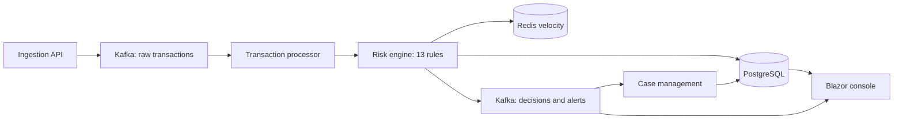

# Sentinel

Sentinel is a C# / .NET 10 portfolio system that shows how a bank or payments team could score card transactions in real time, explain every decision, and hand risky ones to a fraud analyst.

Read [FAILURES.md](./FAILURES.md) for what can go wrong, what broke, how it was fixed, and results.

## What it does

- Accepts card and payment events over HTTP and publishes them to Kafka.
- Enriches each event with Redis velocity windows (1 minute, 5 minutes, 1 hour, 24 hours) and the customer profile.
- Scores the event with 13 independent rules, caps the score at 100, and returns APPROVE, REVIEW or BLOCK.
- Stores every decision in PostgreSQL together with the exact ruleset version that produced it.
- Opens a case for REVIEW and BLOCK, and pushes it to a Blazor analyst console over SignalR.
- Lets analysts add notes and label a case as fraud or a false positive.

All transactions are synthetic. There are no real customers, cards or banks behind this project.

## How it works



1. A transaction enters the ingestion API and is published to `sentinel.transactions.raw.v1`, keyed by `AccountId`.
2. The processor validates it, reads velocity counters from Redis and loads the profile.
3. Each rule implementing `IRiskRule` returns triggered or not, a score and a plain English reason.
4. A separate decision policy turns the capped score into APPROVE, REVIEW or BLOCK.
5. Consumers are idempotent: an inbox table keyed on `EventId` and a unique `TransactionId` on decisions stop Kafka redelivery from creating duplicate cases. See [docs/IDEMPOTENCY.md](docs/IDEMPOTENCY.md).

An optional ML.NET anomaly model (`MlNetAnomalyRiskModel`, off unless `Risk:UseMlNet=true`) can add at most 15 points. By default `NoOpRiskModel` is used, so decisions come from the rules alone.

### Worked example

This scenario is a unit test in `tests/Sentinel.Domain.Tests`.

Input: `TX-928382`, account `A-91828`, £4,850, US merchant, card not present, unknown device, 7 transactions in 5 minutes, typical spend £87.

| Rule | Score |
| --- | --- |
| HIGH_VALUE | +20 |
| FOREIGN_LOCATION | +20 |
| CARD_NOT_PRESENT | +10 |
| UNKNOWN_DEVICE | +15 |
| HIGH_VELOCITY | +30 |
| BEHAVIOURAL_DEVIATION | +15 |
| Raw total | 110 |
| Capped | 100 |
| Decision | BLOCK |

## Quick start

You need the .NET 10 SDK. Integration tests also need Docker.

```bash
git clone https://github.com/TEHILLA-O/sentinel_fraud.git
cd sentinel_fraud
dotnet restore Sentinel.slnx
dotnet test tests/Sentinel.Domain.Tests
dotnet test tests/Sentinel.RuleTests
dotnet test tests/Sentinel.ArchitectureTests
dotnet test tests/Sentinel.PerformanceTests
dotnet test tests/Sentinel.IntegrationTests   # starts PostgreSQL, Redis and Kafka with Testcontainers
```

### Verified test run (1 November 2026, Linux, .NET SDK 10)

| Project | Result |
| --- | --- |
| Sentinel.Domain.Tests | 16 passed |
| Sentinel.RuleTests | 29 passed (after the date fix in commit `aafce70`) |
| Sentinel.ArchitectureTests | 2 passed |
| Sentinel.IntegrationTests | 6 passed, using Testcontainers on a local Docker daemon |
| Sentinel.PerformanceTests | 1 passed |

The performance test printed:

```text
In-process engine P50=0ms P95=0ms P99=0ms
```

That is 250 in-process evaluations of the example above, rounded to whole milliseconds, with no Kafka, Redis or PostgreSQL in the loop. It is not an end-to-end throughput figure. End-to-end throughput has not been measured yet.

### Running the full stack

These commands are documented by the project but were **not verified** in the 1 November 2026 run:

```bash
docker compose up --build
```

| Surface | URL |
| --- | --- |
| Dashboard | http://localhost:8080 |
| Ingestion API | http://localhost:8081 |
| Cases API | http://localhost:8082 |
| Admin API | http://localhost:8083 |
| Kafka UI | http://localhost:8088 |

The database seeder creates a local demo analyst, `analyst@sentinel.local` with password `Sentinel!23`. It exists only for the local demo. Change it before running Sentinel anywhere reachable from a network.

Generate traffic once the stack is up:

```bash
dotnet run --project tools/Sentinel.TransactionGenerator -- --mode mixed --rate 20 --endpoint http://localhost:8081/api/v1/transactions
```

Modes are `normal`, `suspicious`, `fraud-burst` and `mixed`. More detail is in [docs/DEMO.md](docs/DEMO.md).

The .NET Aspire host (`dotnet run --project src/Sentinel.AppHost`) is the other way to start everything. See the known issues below.

## Screenshots

Live operations grid:


Case detail with the triggered rules:


## Project structure

```text
sentinel_fraud/
├── src/
│   ├── Ingestion/Sentinel.Ingestion.Api         HTTP ingress, publishes to Kafka
│   ├── RiskEngine/                              domain rules, application services, Redis and Kafka adapters
│   ├── CaseManagement/Sentinel.Cases.Api        cases, notes, analyst feedback
│   ├── Administration/Sentinel.Admin.Api        ruleset versions and parameters
│   ├── Workers/                                 background consumers
│   ├── Web/Sentinel.Web                         Blazor analyst console
│   ├── BuildingBlocks/                          contracts, eventing, persistence, shared kernel
│   ├── Sentinel.AppHost                         .NET Aspire orchestration
│   └── Sentinel.ServiceDefaults                 OpenTelemetry, health checks, auth
├── tests/                                       domain, rule, architecture, integration and performance tests
├── tools/Sentinel.TransactionGenerator          synthetic traffic generator
├── docker/ and docker-compose.yml               container setup
└── docs/                                        architecture, rules, ADRs, known issues
```

## Kafka topics

| Topic | Purpose |
| --- | --- |
| `sentinel.transactions.raw.v1` | Accepted ingress |
| `sentinel.transactions.validated.v1` | Passed validation |
| `sentinel.risk.decisions.v1` | Explainable scores |
| `sentinel.alerts.v1` | REVIEW and BLOCK |
| `sentinel.deadletter.v1` | Poison messages and exhausted retries |
| `sentinel.profile.updated.v1` | Profile updates |
| `sentinel.case.feedback.v1` | Analyst labels |

## Configuration

- Rule thresholds live in versioned ruleset rows in PostgreSQL and are cached. Historical decisions keep the version they were scored with.
- `Risk:UseMlNet` turns the optional ML.NET model on.
- Connection strings for PostgreSQL, Redis and Kafka come from `appsettings.json`, environment variables or Aspire.
- APIs use JWT. The dashboard uses cookie sign-in. Roles are analyst, senior analyst, risk manager, admin and auditor.

## Limitations and known issues

- **Aspire host does not build without the Aspire CLI.** On 1 November 2026, `dotnet build Sentinel.slnx` failed only on `Sentinel.AppHost` with `ASPIRE009` because Aspire 13.5 now expects the Aspire CLI on `PATH`. Every other project built. Install it from https://get.aspire.dev or use Docker Compose instead.
- **NuGet advisories.** The build reports transitive advisories for `MessagePack` and `Microsoft.OpenApi`. See [docs/KNOWN_ISSUES.md](docs/KNOWN_ISSUES.md).
- **Obsolete Testcontainers constructors** produce warnings in the integration tests.
- `dotnet format --verify-no-changes` is advisory in CI.
- The dashboard reads PostgreSQL directly instead of going through the APIs.
- The ML.NET model is trained on synthetic data only.
- No precision, recall or false positive rate has been measured, because there is no labelled real data. Not measured yet.
- There is no LICENSE file, so by default nobody else has permission to reuse the code.

## Status

Portfolio project. The domain, rules, idempotency and integration tests run and pass on a fresh clone. The full Compose and Aspire stack was not started during this review. Not deployed anywhere.

## Further reading

- [docs/ARCHITECTURE.md](docs/ARCHITECTURE.md)
- [docs/EVENT_FLOW.md](docs/EVENT_FLOW.md)
- [docs/RISK_ENGINE.md](docs/RISK_ENGINE.md) and [docs/RULES.md](docs/RULES.md)
- [docs/IDEMPOTENCY.md](docs/IDEMPOTENCY.md)
- [docs/SECURITY.md](docs/SECURITY.md)
- [docs/PERFORMANCE.md](docs/PERFORMANCE.md)
- [docs/KNOWN_ISSUES.md](docs/KNOWN_ISSUES.md)
- [docs/adr/](docs/adr/) for architecture decisions
- [CONTRIBUTING.md](CONTRIBUTING.md) and [SECURITY.md](SECURITY.md)

## Licence

No licence file has been added yet. All rights are reserved by the author until one is chosen.
